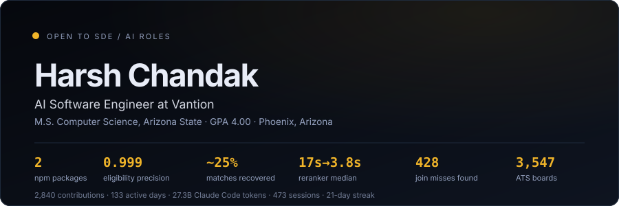
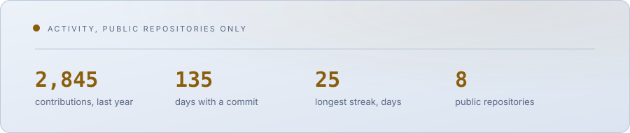
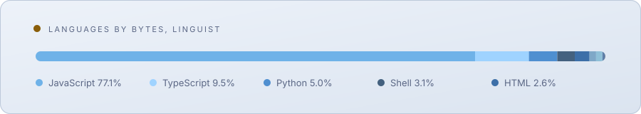

<picture>
  <source media="(prefers-color-scheme: dark)" srcset="assets/header-dark.svg">
  <source media="(prefers-color-scheme: light)" srcset="assets/header-light.svg">
  
</picture>

<sub>The contribution and Claude Code figures in the header are regenerated nightly from a <a href="https://gist.github.com/harsh-chandak/39e44bf9e8257251c0846690406ed283">public gist</a> of aggregates, whose revision history is the audit trail.</sub>


I work on LLM systems where being wrong is expensive.

Most of it is unglamorous. Writing the harness before the feature. Keying a scoring path on an integer instead of a UUID because the reply was output-token-bound. Finding the canonicalization bug that had been hiding a quarter of the eligible matches for months, while the tests stayed green.

---

### Now

**Vantion** · AI Software Engineer · May 2026 to now

I own matching: which scholarships a student is actually eligible for, and in what order.

|  |  |
| --- | --- |
| `0.999` | precision on eligibility across `1,382` awards, after replacing an LLM judge with a rules engine |
| `~25%` | of eligible matches were hidden by a canonicalization bug, across `320` scholarships, fixed with zero regressions |
| `17s → 3.8s` | reranker median, by keying the scoring path on an integer index instead of a UUID |
| `6.3s → 0.15s` | repeat match requests, which now make zero LLM calls |
| `40,000+` | scholarships, extraction cost halved by batching pages under one prompt |

Small team, so the surface is wide. I also isolated the parallel LangGraph advisors, because one crashing agent was taking a student's whole chat turn with it. Moved background jobs onto a durable Postgres queue after deploys kept silently killing them. Made the student app work on a phone in a `79`-file change. Closed source.

<sub>Python · TypeScript · LangGraph · RAG · hybrid search · prompt caching · Postgres · pgvector · Redis · FastAPI · Next.js</sub>

---

### Built

| | |
| --- | --- |
| **[concord-engine](https://github.com/harsh-chandak/concord-engine)** | Holds a fleet of coding agents to one set of decisions, so four workers cannot each answer the same question reasonably and differently. `103` unit tests, a `60`-case loop matrix, `12` MCP tools. On npm and in the MCP registry. |
| **[shadowjoin](https://github.com/harsh-chandak/shadowjoin)** | Measures the matches an exact join is silently dropping. `428` recovered between the S&P 500 and NYSE/Nasdaq listings, `419` confirmed against ticker ground truth, precision `99.76%`. On npm and in the MCP registry. |
| **[job-market-crawler](https://github.com/harsh-chandak/job-market-crawler)** | `3,547` ATS boards polled directly across `11` platforms, `85%` of `28K` daily polls skipped as unchanged, duplicates collapsed, everything ranked before a model is called. |
| **[trustmed](https://github.com/harsh-chandak/trustmed)** | Drug knowledge assistant. Rasa and Neo4j, answering ingredient, generic and substitute questions by traversing a graph instead of matching text. |
| **[zk-coldchain](https://github.com/harsh-chandak/zk-coldchain)** | Zero-knowledge proof that a shipment broke its temperature limit, without revealing the log. Circom and Solidity, with automatic payout. |
| **[data-vis](https://github.com/harsh-chandak/data-vis)** | Linked D3 views over accident data. [Live](https://data-vis-0eqs.onrender.com/) |
| **[krr-project](https://github.com/harsh-chandak/krr-project)** | Multi-robot warehouse planning in answer-set programming. [Live](https://krr-project.onrender.com) |

---

### Before

**Arizona State University** · Software Engineer · Aug 2025 to May 2026 · part-time alongside the M.S.

Built a `200`-input scoring harness first, then halved candidates per input while malformed outputs fell `~20%`. A LangGraph and WhisperX pipeline over `10K+` audio inputs. Telemetry ingestion at `2K+` events a day with idempotency and backpressure, P95 down `~45%`.

**Neuromonk Infotech Pvt. Ltd.** · Full-stack Software Engineer · Jan 2023 to May 2024

Owned four ERP modules used by `70+` manufacturing clients at `20K+` API requests a day. Rebuilt the accounting model for interstate GST; errors hit zero. Dashboards from `4-5s` to under `2s`. Live schema migrations in reversible stages, zero downtime, for clients whose factory floors run on the ERP.

---

### Activity

When the commits actually happen, and what they are written in. Straight from GitHub.

<!--START_SECTION:github-->
<picture>
  <source media="(prefers-color-scheme: dark)" srcset="assets/activity-dark.svg">
  <source media="(prefers-color-scheme: light)" srcset="assets/activity-light.svg">
  
</picture>

<picture>
  <source media="(prefers-color-scheme: dark)" srcset="assets/languages-dark.svg">
  <source media="(prefers-color-scheme: light)" srcset="assets/languages-light.svg">
  
</picture>
<!--END_SECTION:github-->

<sub>Public repositories only. The pull requests and issues that usually fill a
profile card sit in private ones, so a card counting those would read zero and
say nothing true about the work.</sub>

---

### Time

Last seven days in an editor. Terminal work, review and reading do not appear here,
so this undercounts, and it measures where the time went rather than what came of it.

<!--START_SECTION:waka-->

```text
Other        14 hrs 13 mins        ██████████████████▓░░░░░░   74.21 %
JavaScript   2 hrs 11 mins         ███░░░░░░░░░░░░░░░░░░░░░░   11.45 %
TypeScript   1 hr 6 mins           █▒░░░░░░░░░░░░░░░░░░░░░░░   05.78 %
Markdown     59 mins               █▒░░░░░░░░░░░░░░░░░░░░░░░   05.19 %
YAML         33 mins               ▓░░░░░░░░░░░░░░░░░░░░░░░░   02.91 %
JSON         3 mins                ░░░░░░░░░░░░░░░░░░░░░░░░░   00.28 %
```

<!--END_SECTION:waka-->

---

### Rest

M.S. Computer Science, Arizona State, `4.00` · B.Tech Computer Engineering, Pune University, `8.52`

Python · TypeScript · SQL · FastAPI · Node · React · Postgres · Redis · Neo4j · pgvector · Kafka · AWS · Docker · Kubernetes · LangGraph · RAG · hybrid search

Phoenix, Arizona. Open to SDE and AI roles.

<p>
<a href="https://harsh-chandak.com"><picture><source media="(prefers-color-scheme: dark)" srcset="assets/link-site-dark.svg"><source media="(prefers-color-scheme: light)" srcset="assets/link-site-light.svg"></picture></a>
<a href="https://linkedin.com/in/hnchandak"><picture><source media="(prefers-color-scheme: dark)" srcset="assets/link-linkedin-dark.svg"><source media="(prefers-color-scheme: light)" srcset="assets/link-linkedin-light.svg"></picture></a>
<a href="mailto:harshnchandak@gmail.com"><picture><source media="(prefers-color-scheme: dark)" srcset="assets/link-email-dark.svg"><source media="(prefers-color-scheme: light)" srcset="assets/link-email-light.svg"></picture></a>
</p>
